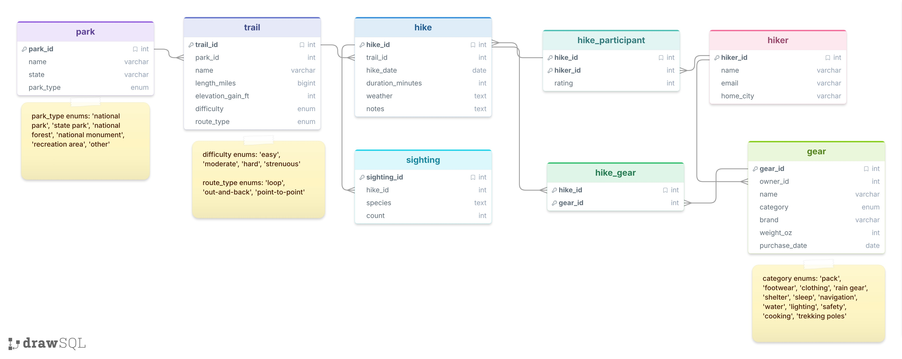

# Hike Tracker

Hike Tracker models a group of friends to log the hikes they go on. This includes which trails they hiked, how difficult they were, who went with them, what gear they brought, and what wildlife they may have seen. It's similar to AllTrails but with a couple more things stored.



**Files:** [`db_bot.py`](db_bot.py) (the app), [`setup.sql`](setup.sql) (schema), [`setupData.sql`](setupData.sql) (sample data), [`results.md`](results.md) (all 10 questions × 3 strategies). Model: `gpt-4o`.

## Query it did well on

**Question:** What gear has never been used on a hike?

**GPT SQL Response** (zero-shot):

```sql
SELECT g.*
FROM gear g
LEFT JOIN hike_gear hg ON g.gear_id = hg.gear_id
WHERE hg.hike_id IS NULL;
```

**SQL Result:** `[(13, 5, 'Atmos AG 65 backpack', 'pack', 'Osprey', 74.0, '2022-06-15'), (15, 4, 'PocketRocket stove', 'cooking', 'MSR', 2.6, '2026-01-10')]`

**Friendly Response:** The gear that has never been used on a hike includes the "Atmos AG 65 backpack" by Osprey and the "PocketRocket stove" by MSR.

All three strategies got this right. Since the gear_id is just a number, it was a fairly straight forward SQL query to get where it did not exist, and GPT did well with that!

## Question that it tripped up on

**Question:** Which trails in Zion are rated strenuous?

**GPT SQL Response** (same for all three strategies):

```sql
SELECT t.name
FROM trail t
JOIN park p ON t.park_id = p.park_id
WHERE p.name = 'Zion' AND t.difficulty = 'strenuous';
```

**SQL Result:** `[]`

**Friendly Response:** It looks like there are no trails in Zion that are currently rated as strenuous according to the data we have.

This is wrong. Angels Landing is in Zion and is rated `strenuous`. The SQL is valid and runs without error, but the park is stored as `'Zion National Park'`, not `'Zion'`. For each strategy, it would try to filter the database with park.name guessing the name was stored as 'Zion' instead of 'Zion National Park', so it returned no results even though Angel's Landing is ranked as strenuous.

The same problem showed up on other prompts as well, such as:

- **Rain question:** `weather LIKE '%rain%'` found 2 of the 5 rainy hikes and missed "afternoon thunderstorms", "drizzle", and "showers". Single-domain did worse with `weather = 'rain'` and found none.

This is an issue because it takes in the question verbatim and cannot infer that a data point may be called something else, shortened, or a synonym because it doesn't have access to the data.

## Prompting strategies

I tried all three strategies from the paper:

- **Zero-shot:** the schema plus the question.
- **Single-domain:** the schema plus one example question and correct SQL from my database ("Which hikers have never been on a hike?").
- **Cross-domain:** an example question and SQL from a _different_ database (the dog show example), then my schema and question.

|                         | Zero-shot | Single-domain | Cross-domain |
| ----------------------- | --------- | ------------- | ------------ |
| Correct answers (of 10) | 6         | 5             | 5            |
| SQL errors              | 1         | 3             | 0            |

**What I noticed:**

- **The strategies mattered less than I expected.** On the easy questions (most hikes, average rating, unused gear, untouched trail), all three wrote nearly identical SQL. On the hard questions, all three made the same mistake (guessing data values).
- **Zero-shot** hit all the errors that single-domain and cross-domain also hit. Though it hit these errors, it wouldn't consistently hit these errors like the others. Sometimes it wouldn't get the 'hike' and 'hiker' databases mixed up.
- **Single-domain** was almost correct but ran into an interesting error. My example query used `h` as the alias for `hiker`. GPT copied that exact havit, then used `h` for the `hike` table and wrote `h.name`, which doesn't exist. Two of its three errors were exactly this. The example taught it a style that didn't transfer perfectly.
- **Cross-domain** usually found an answer but it gave a different answer than the other methods to "What is the hardest trail?" It picked the `'hard'` trails instead of the `'strenuous'` ones. While it found good data, it didn't necessarily find the correct answer.
- **Friendly answers depend on what the SQL selects.** When the query returned only IDs (e.g. owner IDs 4 and 5), the friendly answer said "someone with ID 4" instead of a name. I tried to improve the friendly-answer prompt by also sending the SQL, which helped GPT explain what the columns meant, but it can't get the names from the database that the query never queried for.

## Conclusion

GPT-4o is typically good at the structure of SQL. When it used joins, `GROUP BY`, and `LEFT JOIN ... IS NULL` patterns, the results were almost always right. Its weak spot is that it never sees the data, so it infers string values like park names, species, and weather descriptions, and when those guesses are wrong, the friendly answer confidently states something untrue which can confuse users. For those that don't know the data and trust the results, "no results" looks exactly like a real answer and could cause them to go on dangerous hikes and/or cause them to be completely misinformed about many other things.
